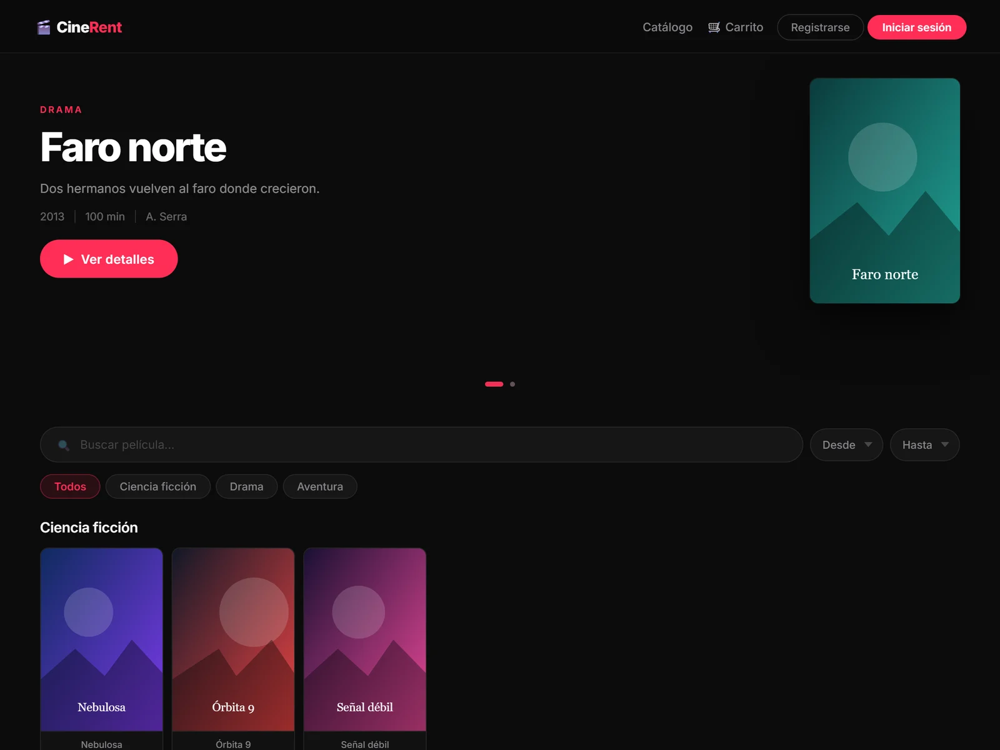

# CineRent · Frontend

**Try the demo**: it runs entirely in the browser with made-up data. Sign in with any email and password; if the email starts with `admin` you get the admin panel.



React and strict TypeScript web app to **rent films online**: catalogue, cart, registration, customer area and admin panel. The backend is cinerent-backend.

- The session is an `HttpOnly` cookie: there is no token in the browser.
- Keyboard-friendly dialogs and labelled forms.
- End-to-end user journeys tested with Vitest and Testing Library.

```bash
npm install
npm run dev      # http://localhost:3000, needs VITE_API_URL
npm run lint && npm test && npm run build
```

More details in the [Spanish README](README.md). [MIT](LICENSE) license.
