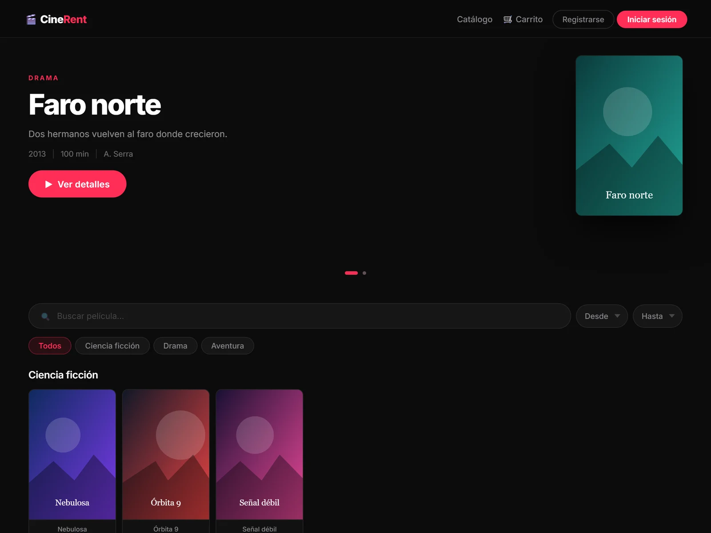

# CineRent · Frontend

[](https://github.com/Serberar/cinerent-frontend/actions/workflows/ci.yml)

**[Probar la demo](https://serberar.github.io/cinerent-frontend/)** · funciona entera en el navegador, con datos ficticios. Entra con cualquier email y contraseña; si el email empieza por `admin`, verás el panel de administración.



Aplicación web en React para **alquilar películas online**: catálogo con filtro por géneros, carrito, registro con verificación de email, área de cliente y panel de administración.

El backend es [cinerent-backend](https://github.com/Serberar/cinerent-backend).

## Páginas

| Ruta | Página |
|---|---|
| `/` | Catálogo de películas con destacadas y selector de géneros. |
| `/carrito` | Carrito de alquiler (días por película) y confirmación. |
| `/login` y `/register` | Acceso y registro. |
| `/verify-email` | Confirmación del email desde el enlace recibido. |
| `/cliente` | Mi cuenta: datos editables y películas alquiladas. |
| `/admin` | Panel de administración: alta y edición de películas y géneros. |

## Tecnologías

- React 18, TypeScript estricto y Vite.
- React Router y Context API.
- Axios, con la sesión en una cookie `HttpOnly`: no hay ningún token en el navegador.
- Vitest, Testing Library y ESLint.

## Cómo arrancarlo

1. Crea un `.env` con la URL del backend:

   ```
   VITE_API_URL=http://localhost:4000
   ```

2. Instala y arranca:

   ```bash
   npm install
   npm run dev    # http://localhost:3000
   ```

La app usa `/api/user`, `/api/product`, `/api/movie`, `/api/genre` y `/api/admin` del backend.

## Pruebas

```bash
npm run lint
npm test        # Vitest y Testing Library, con recorridos completos
npm run build   # genera build/
```

## Licencia

Publicado con licencia [MIT](LICENSE).

## Autor

Sergio Bernabé
